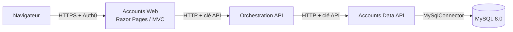

# Accounts System

Une application de gestion des comptes composée de plusieurs services, développée avec ASP.NET Core et exécutée avec Docker Compose. Il s’agit volontairement d’un petit prototype, destiné à illustrer la séparation des services, l’authentification par clé API entre services, la gestion des secrets et le déploiement conteneurisé.

## Architecture



Seul le frontend est exposé en dehors de Docker. Chaque service authentifie celui qui l’appelle avec sa propre clé API, et seule la Data API peut accéder à la base de données.

| Service | Nom Compose | Rôle | Documentation |
|---|---|---|---|
| Accounts Web | `web` | Interface utilisateur et connexion Auth0 | [README](src/Accounts.Web/README.fr.md) |
| Orchestration API | `orchestration-api` | API orientée application, appelle la Data API | [README](src/Accounts.OrchestrationApi/README.fr.md) |
| Accounts Data API | `data-api` | Seul service ayant accès à la base | [README](src/Accounts.DataApi/README.fr.md) |
| MySQL | `db` | Base de données des comptes | — |

## Technologies

.NET 10, ASP.NET Core, Razor Pages, MVC, Clean Architecture, Domain-Driven Design, Auth0, MySQL 8.0, MySqlConnector, Docker Compose avec secrets Docker, xUnit v3.

## Structure du dépôt

```text
accounts-system/
├── src/
│   ├── Accounts.Web/                 Frontend
│   ├── Accounts.OrchestrationApi/    Orchestration API
│   └── Accounts.DataApi/             Data API et ses tests
├── mySQLDb/                          Script d’initialisation de la base
├── secrets.example/                  Modèle du dossier secrets/
├── docker-compose.yaml
└── AccountsSystem.slnx
```

## Démarrage rapide

**Prérequis :** Docker Desktop (ou Docker Engine avec Compose v2) et une application Auth0.

**1. Cloner le dépôt**

```bash
git clone https://github.com/ElisesHub/accounts-system.git
cd accounts-system
```

**2. Créer le dossier des secrets à partir du modèle**

```bash
cp -r secrets.example secrets
```

Remplacez chaque valeur d’exemple dans `secrets/` par une vraie valeur. Chaque fichier contient uniquement la valeur, sans guillemets ni retour à la ligne final.

| Fichier | Utilisé par | Valeur |
|---|---|---|
| `AccountsApiKey.txt` | Orchestration API → Data API | Une chaîne aléatoire robuste |
| `AccountsApplicationApiKey.txt` | Web → Orchestration API | Une chaîne aléatoire robuste |
| `Auth0ClientId.txt` | Web | Fourni par votre application Auth0 |
| `Auth0ClientSecret.txt` | Web | Fourni par votre application Auth0 |
| `MySQLPassword.txt` | MySQL | Mot de passe de l’utilisateur `accounts_user` |
| `MySQLRootPassword.txt` | MySQL | Mot de passe de l’utilisateur root MySQL |
| `AccountsDbConnectionString.txt` | Data API | Chaîne de connexion utilisant le mot de passe de `MySQLPassword.txt` |

Générez la chaîne de connexion à partir du fichier de mot de passe, afin que les deux correspondent toujours :

```bash
printf 'Server=db;Port=3306;Database=AccountsDb;Uid=accounts_user;Pwd=%s;' "$(cat secrets/MySQLPassword.txt)" > secrets/AccountsDbConnectionString.txt
```

Le dossier `secrets/` est ignoré par git. Ne le versionnez jamais.

**3. Définir votre domaine Auth0**

Dans `docker-compose.yaml`, renseignez `Auth0__Domain` dans le service `web` avec le domaine de votre tenant. Dans les paramètres de votre application Auth0, ajoutez `http://localhost:1000/callback` aux Allowed Callback URLs et `http://localhost:1000` aux Allowed Logout URLs.

**4. Construire et démarrer**

```bash
docker compose up --build
```

Ouvrez **http://localhost:1000**.

## Commandes courantes

| Action | Commande |
|---|---|
| Démarrer en arrière-plan | `docker compose up --build -d` |
| Suivre tous les logs | `docker compose logs -f` |
| Suivre un service | `docker compose logs -f data-api` |
| Vérifier l’état | `docker compose ps` |
| Arrêter | `docker compose down` |
| Arrêter et supprimer la base | `docker compose down -v` |

## Base de données

Au premier démarrage, MySQL crée `AccountsDb` et `accounts_user`, puis exécute `mySQLDb/accountsdb_dump_v1.sql`. Ce script ne s’exécute **qu’à la première création du volume**. Pour le relancer après une modification du script ou de `MySQLPassword.txt` :

```bash
docker compose down -v
docker compose up --build
```

`down -v` supprime toutes les données de la base.

## Développement local sans Docker

Chaque service peut être lancé avec `dotnet run` ou depuis Rider avec son profil de lancement. Les paramètres non sensibles se trouvent dans le fichier `appsettings.Development.json` de chaque projet, et les secrets dans les user secrets .NET. Voir le README de chaque service.

| Service | URL locale |
|---|---|
| Accounts Web | http://localhost:5236 |
| Orchestration API | http://localhost:5182 |
| Accounts Data API | http://localhost:5253 |

Ouvrez `AccountsSystem.slnx` pour travailler sur l’ensemble des projets.

## Tests

```bash
dotnet test
```

## Choix de conception

- **Une responsabilité par service.** Le frontend n’a jamais accès à la base, et seule la Data API détient les identifiants de connexion.
- **Authentification entre services.** Chaque API valide un en-tête `x-api-key`, avec une clé distincte pour chaque appel.
- **Des secrets sous forme de fichiers, pas de variables d’environnement.** Les mots de passe et les clés sont des secrets Docker montés dans `/run/secrets`, et n’apparaissent donc ni dans `docker inspect` ni dans l’environnement des processus. Les services .NET les lisent via le provider de configuration key-per-file.
- **Échec rapide en cas de configuration incorrecte.** Chaque service valide ses paramètres obligatoires au démarrage.
- **Moindre privilège dans la base.** La Data API se connecte avec `accounts_user`, et non avec root.

## Améliorations prévues

- Passer l’appel Orchestration → Data API en gRPC, avec un contrat `.proto` partagé
- Exécuter les tests d’intégration sur un conteneur MySQL jetable avec Testcontainers
- Ajouter un pipeline GitHub Actions pour la compilation et les tests
- Aligner les noms de projets et de namespaces sur les dossiers `Accounts.*`

## Dépannage

**`bind source path does not exist: .../secrets/...`** : un fichier de secret est absent ou mal nommé. Comparez `ls secrets` avec le tableau ci-dessus. Les noms sont sensibles à la casse.

**`Access denied for user 'accounts_user'`** : le mot de passe de `AccountsDbConnectionString.txt` ne correspond pas à celui avec lequel MySQL a été initialisé. Régénérez la chaîne de connexion avec la commande `printf` ci-dessus. Si `MySQLPassword.txt` a changé après le premier démarrage, réinitialisez le volume.

**`Unable to connect to any of the specified MySQL hosts`** : la chaîne de connexion doit utiliser `Server=db`, le nom du service Compose, et non `localhost`.

**`PROCEDURE AccountsDb.GetAccounts does not exist`** : la base n’a pas été initialisée à partir du dump. Réinitialisez le volume.

**Une page affiche une erreur** : suivez la requête avec `docker compose logs web orchestration-api data-api` pour identifier le service en échec.

## Avertissement

Ce projet est un prototype simple créé uniquement à des fins de démonstration. Il est fourni « en l’état », sans aucune garantie. Il n’est pas destiné à être utilisé tel quel en production. Avant tout déploiement public ou commercial, il convient de passer en revue la configuration de