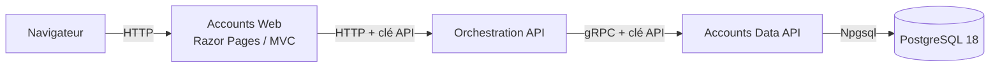

# Accounts System

Une application de gestion des comptes composée de plusieurs services, développée avec ASP.NET Core et exécutée avec Docker Compose. Il s’agit volontairement d’un petit prototype, destiné à illustrer la séparation des services, gRPC entre services, un RPC en streaming côté serveur dans la Data API, l’authentification par clé API, la gestion des secrets et le déploiement conteneurisé.

## Architecture



Seul le frontend est exposé en dehors de Docker. Chaque API authentifie le service qui l’appelle avec sa propre clé API, et seule la Data API peut accéder à la base de données.

| Service | Nom Compose | Rôle | Documentation |
|---|---|---|---|
| Accounts Web | `web` | Interface utilisateur ; connexion Auth0 configurée mais pas encore obligatoire | [README](src/Accounts.Web/README.fr.md) |
| Orchestration API | `orchestration-api` | API REST orientée application ; client gRPC de la Data API | [README](src/Accounts.OrchestrationApi/README.fr.md) |
| Accounts Data API | `data-api` | Sert du gRPC (plus un endpoint `/health`) ; seul service ayant accès à la base | [README](src/Accounts.DataApi/README.fr.md) |
| PostgreSQL | `db` | Base de données des comptes | — |

## Pourquoi cette architecture

Cette application n’a pas besoin d’une architecture en trois couches. À sa taille, une application Blazor Server ou MVC avec une couche de services qui accède directement à la base serait le choix le plus adapté.

Elle est volontairement découpée en services, afin d’illustrer la communication entre services : un contrat Protocol Buffers partagé, des appels gRPC unaires entre les API, un RPC en streaming côté serveur, les deadlines et l’annulation à travers le réseau, et le mapping des erreurs d’un service à l’autre. Dans un système réel, un service de données interne distinct devient pertinent lorsque plusieurs consommateurs partagent les mêmes données, lorsque différentes équipes sont responsables de différents services, ou lorsque les services doivent être déployés et scalés indépendamment.

L’Orchestration API est le seul service avec lequel le frontend communique. Elle traduit les appels REST du frontend en appels gRPC vers la Data API, et c’est le seul service qui peut appeler la Data API.

## Technologies

.NET 10, ASP.NET Core, Razor Pages, MVC, API REST, gRPC (`Grpc.AspNetCore`, `Grpc.Net.ClientFactory`), Protocol Buffers, PostgreSQL 18, Npgsql, Clean Architecture, Domain-Driven Design, Auth0, Docker Compose avec secrets Docker, xUnit v3, Testcontainers.

## Structure du dépôt

```text
accounts-system/
├── src/
│   ├── Accounts.Web/                 Frontend
│   ├── Accounts.OrchestrationApi/    Orchestration API (REST en entrée, gRPC en sortie)
│   └── Accounts.DataApi/             Data API (gRPC) et ses tests
├── protos/
│   ├── accounts/v1/                  Contrat accounts.v1.AccountsService
│   └── statements/v1/                Contrat statements.v1.StatementsService
├── DbFiles/init/                     Scripts d’initialisation de la base
├── secrets.example/                  Modèle du dossier secrets/
├── docker-compose.yaml
└── AccountsSystem.slnx
```

## Démarrage rapide

**Prérequis :** Docker Desktop (ou Docker Engine avec Compose v2).

**1. Cloner le dépôt**

```bash
git clone https://github.com/ElisesHub/accounts-system.git
cd accounts-system
```

**2. Créer le dossier des secrets à partir du modèle**

```bash
cp -r secrets.example secrets
```

Remplacez chaque valeur d’exemple dans `secrets/` par une vraie valeur. Chaque fichier contient uniquement la valeur, sans guillemets et **sans retour à la ligne final**. Le plus sûr est d’écrire chaque fichier avec `printf` :

```bash
printf '%s' 'votre-valeur' > secrets/DbAppPassword.txt
```

| Fichier | Utilisé par | Valeur |
|---|---|---|
| `AccountsApiKey.txt` | Orchestration API → Data API | Une chaîne aléatoire robuste |
| `AccountsApplicationApiKey.txt` | Web → Orchestration API | Une chaîne aléatoire robuste |
| `Auth0ClientId.txt` | Web | Conserver la valeur d’exemple |
| `Auth0ClientSecret.txt` | Web | Conserver la valeur d’exemple |
| `DbAdminPassword.txt` | PostgreSQL | Mot de passe du superutilisateur `accounts_admin` (initialisation de la base uniquement) |
| `DbAppPassword.txt` | PostgreSQL et Data API | Mot de passe du rôle `accounts_app` avec lequel la Data API se connecte |

Le dossier `secrets/` est ignoré par git. Ne le versionnez jamais.

**3. Construire et démarrer**

```bash
docker compose up --build
```

Ouvrez **http://localhost:1000**.

## Commandes courantes

| Action | Commande |
|---|---|
| Démarrer en arrière-plan | `docker compose up --build -d` |
| Suivre tous les logs | `docker compose logs -f` |
| Suivre un service | `docker compose logs -f data-api` |
| Vérifier l’état | `docker compose ps` |
| Arrêter | `docker compose down` |
| Arrêter et supprimer la base | `docker compose down -v` |

## Base de données

Le service `db` exécute PostgreSQL 18. Au premier démarrage, le conteneur exécute les scripts de `DbFiles/init/` par ordre alphabétique :

1. **`00_create_app_role.sh`** crée le rôle `accounts_app`, avec le mot de passe de `DbAppPassword.txt`, et lui accorde l’accès en lecture à toutes les tables créées ensuite.
2. **`01_schema_and_seed.sql`** crée le schéma et charge des données d’exemple.

Ces scripts ne s’exécutent **que lorsque le volume de données est vide**. Pour les relancer après une modification d’un script ou d’un mot de passe :

```bash
docker compose down -v
docker compose up --build
```

`down -v` supprime toutes les données de la base.

**Rôles.** `accounts_admin` est le superutilisateur et ne sert qu’à initialiser la base. La Data API se connecte avec `accounts_app`, qui peut lire les données mais pas modifier le schéma.

**Schéma.**


Les `customers` possèdent des `accounts`. Chaque compte a une devise, un découvert autorisé et un statut. Les `transactions` forment un ledger immuable en partie simple : les montants sont signés (positifs en entrée, négatifs en sortie), chaque transaction a une catégorie issue de `transaction_types`, et une `idempotency_key` unique empêche d’enregistrer deux fois la même transaction. Le solde stocké de chaque compte (`balance`) est égal à la somme de ses transactions.

**Requêtes.** La Data API utilise du SQL inline dans ses repositories plutôt que des fonctions ou des procédures stockées. Comme la Data API est le seul accès à la base, chaque requête se trouve à un seul endroit, à côté du code qui l’utilise.

## Contrats gRPC

Les contrats se trouvent dans `protos/` et sont compilés à la fois dans la Data API (serveur) et dans l’Orchestration API (client).

| Service | RPC | Type |
|---|---|---|
| `accounts.v1.AccountsService` | `GetAccount` | Unaire |
| `accounts.v1.AccountsService` | `GetAccounts` | Unaire |
| `statements.v1.StatementsService` | `GetTransactions` | Streaming côté serveur |

La Data API écoute sur deux ports : **8080** (HTTP/1.1) pour `/health`, et **8081** (HTTP/2) pour gRPC. Chaque appel gRPC nécessite un en-tête `x-api-key`.

### Streaming des relevés

`GetTransactions` renvoie les transactions d’un compte en streaming, un message par transaction, par ordre chronologique. Les lignes sont lues dans PostgreSQL, mappées et écrites dans la réponse gRPC une par une : aucune couche ne charge le relevé complet en mémoire. Si le client se déconnecte ou si sa deadline expire, l’annulation remonte jusqu’à la requête en base.

Le service vérifie que le compte existe **avant** de commencer le flux : un compte inexistant renvoie donc `NotFound` plutôt qu’un flux vide. Un identifiant de compte invalide renvoie `InvalidArgument`.

## Tests

```bash
dotnet test
```

Docker doit être lancé : les tests d’intégration utilisent Testcontainers pour démarrer un conteneur PostgreSQL 18 jetable, initialisé avec les mêmes scripts de `DbFiles/init/` que Docker Compose. La Data API s’exécute ensuite en mémoire, et les tests l’appellent via un vrai client gRPC, y compris pour le RPC en streaming.

## Choix de conception

- **Une responsabilité par service.** Le frontend n’a jamais accès à la base, et seule la Data API détient les identifiants de connexion.
- **Authentification entre services.** Chaque API valide un en-tête `x-api-key`, avec une clé distincte pour chaque appel.
- **Des secrets sous forme de fichiers, pas de variables d’environnement.** Les mots de passe et les clés sont des secrets Docker montés dans `/run/secrets`, et n’apparaissent donc ni dans `docker inspect` ni dans l’environnement des processus. Les services .NET les lisent via le provider de configuration key-per-file. Seule la partie sensible de la connexion à la base (le mot de passe) est un secret ; l’hôte, la base et le nom d’utilisateur relèvent de la configuration ordinaire.
- **Fail fast sur la configuration.** Chaque service valide ses paramètres obligatoires au démarrage.
- **Moindre privilège dans la base.** La Data API se connecte avec `accounts_app`, un rôle en lecture seule, et jamais avec le superutilisateur.
- **Une seule convention d’erreurs.** Les résultats attendus (ressource introuvable, saisie invalide) sont renvoyés sous forme de résultats et traduits en codes de statut gRPC à un seul endroit. Les états de résultat inattendus sont enregistrés dans les logs une seule fois côté serveur, et l’appelant reçoit un message générique accompagné d’un trace ID.

## Dépannage

**`bind source path does not exist: .../secrets/...`** : un fichier de secret est absent ou mal nommé. Comparez `ls secrets` avec le tableau ci-dessus. Les noms sont sensibles à la casse.

**`password authentication failed for user "accounts_app"`** : le rôle n’existe pas ou a un autre mot de passe. PostgreSQL renvoie la même erreur dans les deux cas. En général, la base a été initialisée avant que `DbAppPassword.txt` ait sa valeur actuelle. Réinitialisez le volume avec `docker compose down -v`.

**La base démarre vide, ou `accounts_app` n’existe pas** : vérifiez dans `docker compose logs db` que les deux scripts d’initialisation se sont exécutés. Si aucun ne s’est exécuté, le volume contenait déjà des données ; réinitialisez-le. Si le dossier `/docker-entrypoint-initdb.d` est vide dans le conteneur, les scripts ne se trouvent pas dans `DbFiles/init/`.
## Avertissement

Ce projet est un prototype simple créé uniquement à des fins de démonstration. Il est fourni « en l’état », sans aucune garantie. Il n’est pas destiné à être utilisé tel quel en production. Avant tout déploiement public ou commercial, il convient de passer en revue la configuration de sécurité, la gestion des secrets, la configuration de la base de données, le flux d’authentification, la gestion des erreurs, la journalisation et les paramètres d’infrastructure.