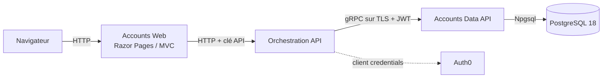
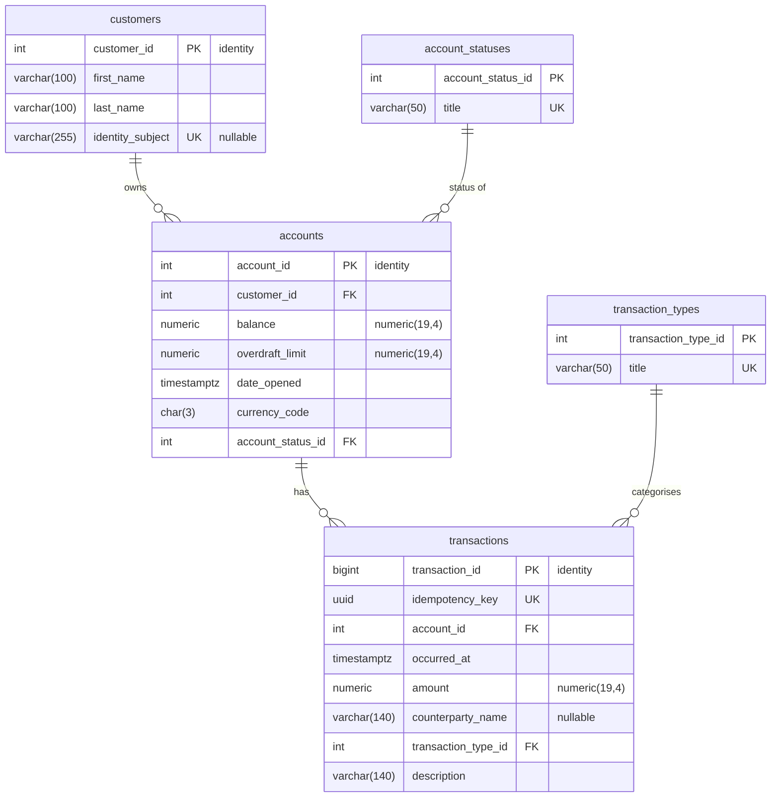

# Accounts System

Une application de gestion de comptes multi-services, développée avec ASP.NET Core et exécutée avec Docker Compose. C'est un prototype volontairement réduit, qui illustre la séparation des services, gRPC entre les services, un RPC en streaming serveur dans la Data API, l'authentification entre services par clés API et JWT, TLS entre les services, les health checks, la gestion des secrets, le déploiement conteneurisé et une CI sur chaque pull request.

## Architecture



Seul le frontend est exposé en dehors de Docker. Le frontend s'authentifie auprès de l'Orchestration API avec une clé API. L'Orchestration API appelle la Data API via TLS, en envoyant un jeton d'accès Auth0 obtenu par le flux client credentials, et la Data API exige le scope `read:accounts`. Seule la Data API peut accéder à la base de données.

| Service | Nom Compose | Rôle | Docs |
|---|---|---|---|
| Accounts Web | `web` | Interface utilisateur ; connexion Auth0 configurée mais pas encore obligatoire | [README](src/Accounts.Web/README.md) |
| Orchestration API | `orchestration-api` | API REST exposée à l'application ; client gRPC de la Data API ; `/health/live` | [README](src/Accounts.OrchestrationApi/README.md) |
| Accounts Data API | `data-api` | Sert gRPC via TLS, ainsi que `/health/live` et `/health/ready` ; seul service ayant accès à la base de données | [README](src/Accounts.DataApi/README.md) |
| PostgreSQL | `db` | Base de données des comptes | — |

## Pourquoi cette architecture

Cette application n'a pas besoin de trois niveaux. À sa taille, une application Blazor Server ou MVC avec une couche de services accédant directement à la base de données serait la bonne conception.

Elle est découpée en services volontairement, pour illustrer la communication entre services : un contrat Protocol Buffers partagé, des appels gRPC unaires entre les API, un RPC en streaming serveur, les deadlines et l'annulation à travers une frontière réseau, et la traduction des erreurs entre services. Dans un système réel, un service de données interne distinct devient rentable lorsque plusieurs consommateurs partagent les mêmes données, lorsque des équipes différentes possèdent des services différents, ou lorsque les services doivent être déployés et mis à l'échelle indépendamment.

L'Orchestration API est le seul service avec lequel le frontend communique. Elle fait la traduction entre l'API REST utilisée par le frontend et le contrat gRPC de la Data API, et c'est le seul service autorisé à appeler la Data API.

## Technologies

.NET 10, ASP.NET Core, Razor Pages, MVC, API REST, gRPC (`Grpc.AspNetCore`, `Grpc.Net.ClientFactory`), Protocol Buffers, buf, PostgreSQL 18, Npgsql, Clean Architecture, Domain-Driven Design, Auth0 (OIDC et client credentials), authentification JWT bearer, TLS avec une autorité de certification privée (mkcert), health checks ASP.NET Core, logs JSON structurés, Docker Compose avec Docker secrets, xUnit v3, Testcontainers, GitHub Actions.

## Structure du dépôt

```text
accounts-system/
├── .github/workflows/                CI : contrôles des protos, build et tests
├── src/
│   ├── Accounts.Web/                 Frontend
│   ├── Accounts.OrchestrationApi/    Orchestration API (REST en entrée, gRPC en sortie) et ses tests
│   └── Accounts.DataApi/             Data API (gRPC) et ses tests
├── protos/
│   ├── accounts/v1/                  Contrat accounts.v1.AccountsService
│   └── statements/v1/                Contrat statements.v1.StatementsService
├── DbFiles/init/                     Scripts d'initialisation de la base de données
├── secrets.example/                  Modèle du dossier secrets/
├── buf.yaml, buf.lock                Configuration du lint Protobuf et de la détection des changements incompatibles
├── docker-compose.yaml
└── AccountsSystem.slnx
```

## Démarrage rapide

**Prérequis :**

- Docker Desktop (ou Docker Engine avec Compose v2)
- [mkcert](https://github.com/FiloSottile/mkcert), pour créer les certificats TLS
- Un tenant Auth0 avec une API qui définit le scope `read:accounts`, et une application machine-to-machine autorisée pour cette API. L'Orchestration API utilise cette application pour obtenir des jetons d'accès à la Data API.

**1. Cloner le dépôt**

```bash
git clone https://github.com/ElisesHub/accounts-system.git
cd accounts-system
```

**2. Créer le dossier des secrets à partir du modèle**

```bash
cp -r secrets.example secrets
```

Remplacez chaque valeur d'exemple dans `secrets/` par une vraie valeur. Chaque fichier contient uniquement la valeur, sans guillemets et **sans retour à la ligne final**. Le plus sûr est d'écrire chaque fichier avec `printf` :

```bash
printf '%s' 'votre-valeur' > secrets/DbAppPassword.txt
```

| Fichier | Utilisé par | Valeur |
|---|---|---|
| `AccountsApplicationApiKey.txt` | Web → Orchestration API | Toute chaîne aléatoire robuste |
| `Auth0ClientId.txt` | Web | Client ID de l'application Auth0 utilisée pour la connexion |
| `Auth0ClientSecret.txt` | Web | Client secret de la même application |
| Client ID et client secret Auth0 de l'Orchestration API (voir `secrets.example/`) | Orchestration API | Identifiants de l'application Auth0 machine-to-machine |
| `DbAdminPassword.txt` | PostgreSQL | Mot de passe du superutilisateur `accounts_admin` (initialisation de la base uniquement) |
| `DbAppPassword.txt` | PostgreSQL et Data API | Mot de passe du rôle `accounts_app` utilisé par la Data API pour se connecter |
| `data-api.crt`, `data-api.key` | Data API | Certificat TLS et clé privée (voir [TLS entre les services](#tls-entre-les-services)) |
| `Shared/ca.crt` | Orchestration API | Certificat racine de l'autorité qui a émis le certificat de la Data API |

`secrets/` est ignoré par git. Ne le commitez jamais.

**3. Créer les certificats TLS**

Suivez [TLS entre les services](#tls-entre-les-services).

**4. Construire et démarrer**

```bash
docker compose up --build
```

Ouvrez **http://localhost:1000**.

## Commandes courantes

| Tâche | Commande |
|---|---|
| Démarrer en arrière-plan | `docker compose up --build -d` |
| Suivre tous les logs | `docker compose logs -f` |
| Suivre un seul service | `docker compose logs -f data-api` |
| Voir l'état | `docker compose ps` |
| Arrêter | `docker compose down` |
| Arrêter et supprimer la base de données | `docker compose down -v` |

## TLS entre les services

La Data API sert gRPC en HTTPS avec un certificat émis par une autorité de certification privée, créée localement avec mkcert. L'Orchestration API fait confiance à cette autorité pour cette connexion. La validation des certificats n'est jamais désactivée.

```bash
mkcert -cert-file data-api.crt -key-file data-api.key data-api
cp "$(mkcert -CAROOT)/rootCA.pem" secrets/Shared/ca.crt
```

Déplacez `data-api.crt` et `data-api.key` dans `secrets/`, à l'emplacement indiqué dans `secrets.example/`. Le certificat est émis pour le nom d'hôte `data-api`, le nom du service Compose auquel l'Orchestration API se connecte.

La clé privée de l'autorité (`rootCA-key.pem`) reste dans le dossier de l'autorité mkcert. Elle n'est jamais copiée dans le dépôt ni dans un conteneur.

Lorsque la Data API s'exécute en dehors de Docker, elle utilise à la place le certificat de développement .NET.

## Base de données

Le service `db` exécute PostgreSQL 18. Au premier démarrage, le conteneur exécute les scripts de `DbFiles/init/` par ordre alphabétique :

1. **`00_create_app_role.sh`** crée le rôle `accounts_app` avec le mot de passe de `DbAppPassword.txt`, et lui accorde l'accès en lecture à toutes les tables créées ensuite.
2. **`01_schema_and_seed.sql`** crée le schéma et charge des données d'exemple.

Ces scripts s'exécutent **uniquement lorsque le volume de données est vide**. Pour les relancer après avoir modifié un script ou un mot de passe :

```bash
docker compose down -v
docker compose up --build
```

`down -v` supprime toutes les données de la base.

**Rôles.** `accounts_admin` est le superutilisateur et ne sert qu'à initialiser la base. La Data API se connecte en tant que `accounts_app`, qui peut lire les données mais ne peut pas modifier le schéma.

**Schéma.**



Les `customers` possèdent des `accounts`. Chaque compte a une devise, une autorisation de découvert et un statut. Les `transactions` forment un registre immuable en partie simple : les montants sont signés (positifs en entrée, négatifs en sortie), chaque transaction a une catégorie issue de `transaction_types`, et une `idempotency_key` unique empêche d'enregistrer deux fois la même transaction. Le `balance` stocké de chaque compte est égal à la somme de ses transactions.

**Requêtes.** La Data API utilise du SQL inline dans ses repositories plutôt que des fonctions ou des procédures stockées. Comme la Data API est le seul accès à la base de données, chaque requête se trouve à un seul endroit, à côté du code qui l'utilise.

## Contrats gRPC

Les contrats se trouvent dans `protos/`. La Data API sert les deux services, et l'Orchestration API est cliente d'`AccountsService`.

| Service | RPC | Type |
|---|---|---|
| `accounts.v1.AccountsService` | `GetAccount` | Unaire |
| `accounts.v1.AccountsService` | `GetAccounts` | Unaire |
| `statements.v1.StatementsService` | `GetTransactions` | Streaming serveur |

La Data API écoute sur deux ports : **8080** (HTTP/1.1) pour les health checks, et **8081** (HTTPS, HTTP/2) pour gRPC. Chaque appel gRPC nécessite un jeton bearer avec le scope `read:accounts`.

### Streaming des relevés

`GetTransactions` envoie les transactions d'un compte en streaming, un message par transaction, par ordre chronologique. Les lignes sont lues depuis PostgreSQL, mappées et écrites dans la réponse gRPC une par une, si bien qu'aucune couche ne garde le relevé entier en mémoire. Si le client se déconnecte ou si sa deadline expire, l'annulation remonte jusqu'à la requête en base.

Le service vérifie que le compte existe **avant** de lancer le streaming : un compte inexistant renvoie donc `NotFound` plutôt qu'un flux vide. Un identifiant de compte invalide renvoie `InvalidArgument`.

### Gouvernance des contrats

Les contrats sont vérifiés avec [buf](https://buf.build) : `buf lint` applique les règles `STANDARD`, et `buf breaking` rejette les changements qui casseraient des clients déjà déployés, comme renuméroter, changer le type ou supprimer un champ.

```bash
buf lint
buf breaking --against '.git#branch=main'
```

## Health checks

| Endpoint | Services | Vérifie |
|---|---|---|
| `/health/live` | Orchestration API, Data API | Le processus tourne ; aucune vérification des dépendances |
| `/health/ready` | Data API | La base de données est joignable |

Les deux endpoints sont accessibles sans authentification. Ils sont conçus pour servir de sondes liveness et readiness à un orchestrateur comme Kubernetes.

## Tests

```bash
dotnet test AccountsSystem.slnx
```

Docker doit être démarré. Les tests d'intégration de la Data API utilisent Testcontainers pour lancer un conteneur PostgreSQL 18 jetable, initialisé avec les mêmes scripts de `DbFiles/init/` que Docker Compose. La Data API s'exécute ensuite en mémoire, et les tests l'appellent via un vrai client gRPC, y compris le RPC en streaming. Les tests de l'Orchestration API exécutent l'API en mémoire avec une configuration de test.

## Intégration continue

Chaque pull request déclenche deux workflows GitHub Actions :

| Workflow | Job | Vérifications |
|---|---|---|
| Proto checks | `buf` | `buf lint`, et `buf breaking` par rapport à la branche cible de la pull request |
| .NET | `build-and-test` | Build Release de la solution et exécution de tous les tests, y compris les tests d'intégration Testcontainers |

`main` est protégée : les changements passent par des pull requests, et les deux vérifications doivent réussir avant le merge.

## Notes de conception

- **Une responsabilité par service.** Le frontend ne voit jamais la base de données, et seule la Data API détient les identifiants de la base.
- **Authentification entre services.** L'Orchestration API valide une clé API envoyée par le frontend. La Data API valide un jeton d'accès JWT émis par Auth0 et exige le scope `read:accounts` sur chaque service gRPC.
- **Sécurisé par défaut.** Les deux API appliquent une politique d'autorisation par défaut (fallback policy) : chaque endpoint exige une authentification, sauf s'il en est explicitement exempté, comme les health checks.
- **Appels entre services chiffrés et vérifiés.** L'Orchestration API appelle la Data API via TLS et ne fait confiance qu'à l'autorité privée qui a émis le certificat de la Data API.
- **Les secrets sont des fichiers, pas des variables d'environnement.** Mots de passe, clés et certificats sont des Docker secrets montés sous `/run/secrets` : ils n'apparaissent ni dans `docker inspect` ni dans l'environnement des processus. Les services .NET les lisent via le fournisseur de configuration key-per-file. Seule la partie secrète de la connexion à la base (le mot de passe) est un secret ; l'hôte, la base et le nom d'utilisateur sont de la configuration ordinaire.
- **Échec rapide sur la configuration.** Chaque service valide ses paramètres obligatoires au démarrage.
- **Moindre privilège en base de données.** La Data API se connecte en tant que `accounts_app`, un rôle en lecture seule, jamais en tant que superutilisateur.
- **Une seule convention d'erreur.** Les résultats attendus (introuvable, entrée invalide) sont renvoyés comme résultats et traduits en codes de statut gRPC à un seul endroit. Les erreurs inattendues sont journalisées une seule fois côté serveur, et l'appelant reçoit un message générique avec un identifiant de trace.
- **Logs structurés.** En dehors de l'environnement Development, les deux API écrivent des logs JSON sur la console, avec les identifiants de trace et de span.

## Dépannage

**`bind source path does not exist: .../secrets/...`** : un fichier secret est manquant ou mal nommé. Comparez `ls -R secrets` avec le tableau ci-dessus. Les noms sont sensibles à la casse.

**`password authentication failed for user "accounts_app"`** : le rôle n'existe pas ou a un autre mot de passe. PostgreSQL renvoie la même erreur dans les deux cas. En général, la base a été initialisée avant que `DbAppPassword.txt` ait sa valeur actuelle. Réinitialisez le volume avec `docker compose down -v`.

**La base démarre vide, ou `accounts_app` n'existe pas** : vérifiez dans `docker compose logs db` que les deux scripts d'initialisation ont été exécutés. Si aucun ne l'a été, le volume contenait déjà des données ; réinitialisez-le. Si le dossier `/docker-entrypoint-initdb.d` est vide dans le conteneur, les scripts ne sont pas dans `DbFiles/init/`.

**L'Orchestration API ne parvient pas à se connecter à la Data API (erreurs de certificat ou SSL)** : `Shared/ca.crt` est manquant, ou provient d'une autre autorité mkcert que celle qui a émis `data-api.crt`. Régénérez les deux sur la même machine.

**La Data API renvoie `Unauthenticated` ou `PermissionDenied`** : le jeton d'accès est absent, a une mauvaise audience, ou l'application machine-to-machine n'a pas reçu le scope `read:accounts` dans Auth0.

## Avertissement

Ce projet est un simple prototype créé uniquement à des fins de démonstration. Il est fourni « en l'état », sans garantie d'aucune sorte. Il n'est pas destiné à être utilisé tel quel en production. Avant tout déploiement public ou commercial, revoyez la configuration de sécurité, la gestion des secrets, la configuration de la base de données, le flux d'authentification, la gestion des erreurs, les logs et les paramètres d'infrastructure.