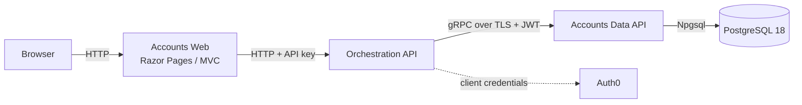
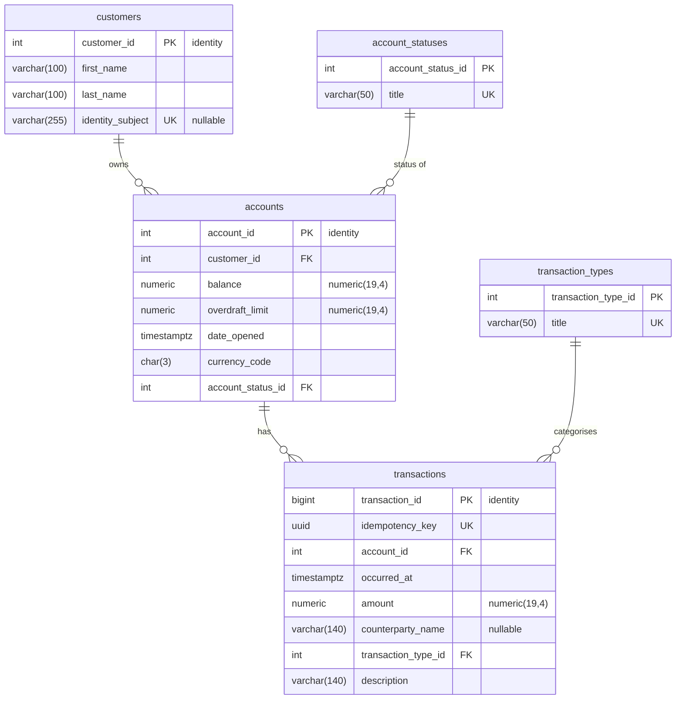

# Accounts System

A multi-service accounts application built with ASP.NET Core and run with Docker Compose. It is a deliberately small prototype, used to demonstrate service separation, gRPC between services, a server-streaming RPC in the Data API, service-to-service authentication with API keys and JWTs, TLS between services, health checks, secrets management, containerised deployment and CI on every pull request.

## Architecture



Only the frontend is exposed outside Docker. The frontend authenticates to the Orchestration API with an API key. The Orchestration API calls the Data API over TLS, sending an Auth0 access token obtained with the client credentials flow, and the Data API requires the `read:accounts` scope. Only the Data API can reach the database.

| Service | Compose name | Role | Docs |
|---|---|---|---|
| Accounts Web | `web` | User interface; Auth0 sign-in configured but not yet required | [README](src/Accounts.Web/README.md) |
| Orchestration API | `orchestration-api` | Application-facing REST API; gRPC client of the Data API; `/health/live` | [README](src/Accounts.OrchestrationApi/README.md) |
| Accounts Data API | `data-api` | Serves gRPC over TLS, plus `/health/live` and `/health/ready`; the only service with database access | [README](src/Accounts.DataApi/README.md) |
| PostgreSQL | `db` | Accounts database | — |

## Why this architecture

This application doesn't need three tiers. At its size, a Blazor Server or MVC app with a service layer talking directly to the database would be the right design.

It is split into services on purpose, to demonstrate service-to-service communication: a shared Protocol Buffers contract, unary gRPC calls between the APIs, a server-streaming RPC, deadlines and cancellation across a network boundary, and mapping errors between services. In a real system, a separate internal data service starts to pay off when several consumers share the same data, when different teams own different services, or when services need to be deployed and scaled independently.

The Orchestration API is the only service the frontend talks to. It translates between the REST API the frontend uses and the gRPC contract of the Data API, and it is the only service that can call the Data API.

## Technologies

.NET 10, ASP.NET Core, Razor Pages, MVC, REST APIs, gRPC (`Grpc.AspNetCore`, `Grpc.Net.ClientFactory`), Protocol Buffers, buf, PostgreSQL 18, Npgsql, Clean Architecture, Domain-Driven Design, Auth0 (OIDC and client credentials), JWT bearer authentication, TLS with a private CA (mkcert), ASP.NET Core health checks, structured JSON logging, Docker Compose with Docker secrets, xUnit v3, Testcontainers, GitHub Actions.

## Repository structure

```text
accounts-system/
├── .github/workflows/                CI: proto checks, build and test
├── src/
│   ├── Accounts.Web/                 Frontend
│   ├── Accounts.OrchestrationApi/    Orchestration API (REST in, gRPC out) and its tests
│   └── Accounts.DataApi/             Data API (gRPC) and its tests
├── protos/
│   ├── accounts/v1/                  accounts.v1.AccountsService contract
│   └── statements/v1/                statements.v1.StatementsService contract
├── DbFiles/init/                     Database initialisation scripts
├── secrets.example/                  Template for the secrets/ folder
├── buf.yaml, buf.lock                Protobuf lint and breaking-change configuration
├── docker-compose.yaml
└── AccountsSystem.slnx
```

## Quick start

**Prerequisites:**

- Docker Desktop (or Docker Engine with Compose v2)
- [mkcert](https://github.com/FiloSottile/mkcert), to create the TLS certificates
- An Auth0 tenant with an API that defines the `read:accounts` scope, and a machine-to-machine application authorised for that API. The Orchestration API uses this application to get access tokens for the Data API.

**1. Clone the repository**

```bash
git clone https://github.com/ElisesHub/accounts-system.git
cd accounts-system
```

**2. Create the secrets folder from the template**

```bash
cp -r secrets.example secrets
```

Replace every placeholder in `secrets/` with a real value. Each file contains only the value, with no quotes and **no trailing newline**. The safest way to write one is with `printf`:

```bash
printf '%s' 'your-value-here' > secrets/DbAppPassword.txt
```

| File | Used by | Value |
|---|---|---|
| `AccountsApplicationApiKey.txt` | Web → Orchestration API | Any strong random string |
| `Auth0ClientId.txt` | Web | Client ID of the Auth0 application used for sign-in  |
| `Auth0ClientSecret.txt` | Web | Client secret of the same application |
| Orchestration API Auth0 client ID and secret (see `secrets.example/`) | Orchestration API | Credentials of the Auth0 machine-to-machine application |
| `DbAdminPassword.txt` | PostgreSQL | Password for the `accounts_admin` superuser (database setup only) |
| `DbAppPassword.txt` | PostgreSQL and Data API | Password for the `accounts_app` role the Data API connects as |
| `data-api.crt`, `data-api.key` | Data API | TLS certificate and private key (see [TLS between services](#tls-between-services)) |
| `Shared/ca.crt` | Orchestration API | Root certificate of the CA that issued the Data API certificate |

`secrets/` is ignored by git. Never commit it.

**3. Create the TLS certificates**

Follow [TLS between services](#tls-between-services).

**4. Build and start**

```bash
docker compose up --build
```

Open **http://localhost:1000**.

## Everyday commands

| Task | Command |
|---|---|
| Start in the background | `docker compose up --build -d` |
| Follow all logs | `docker compose logs -f` |
| Follow one service | `docker compose logs -f data-api` |
| Check status | `docker compose ps` |
| Stop | `docker compose down` |
| Stop and delete the database | `docker compose down -v` |

## TLS between services

The Data API serves gRPC over HTTPS with a certificate issued by a private certificate authority, created locally with mkcert. The Orchestration API trusts that CA for this connection. Certificate validation is never disabled.

```bash
mkcert -cert-file data-api.crt -key-file data-api.key data-api
cp "$(mkcert -CAROOT)/rootCA.pem" secrets/Shared/ca.crt
```

Move `data-api.crt` and `data-api.key` into `secrets/`, in the location shown in `secrets.example/`. The certificate is issued for the host name `data-api`, the Compose service name the Orchestration API connects to.

The CA's private key (`rootCA-key.pem`) stays in mkcert's CA folder. It is never copied into the repository or into a container.

When the Data API runs outside Docker, it uses the .NET development certificate instead.

## Database

The `db` service runs PostgreSQL 18. On first start, the container runs the scripts in `DbFiles/init/` in alphabetical order:

1. **`00_create_app_role.sh`** creates the `accounts_app` role, using the password from `DbAppPassword.txt`, and grants it read access to every table created afterwards.
2. **`01_schema_and_seed.sql`** creates the schema and loads sample data.

These scripts run **only when the data volume is empty**. To re-run them after changing a script or a password:

```bash
docker compose down -v
docker compose up --build
```

`down -v` deletes all database data.

**Roles.** `accounts_admin` is the superuser and is used only to initialise the database. The Data API connects as `accounts_app`, which can read data but cannot change the schema.

**Schema.**



`customers` own `accounts`. Each account has a currency, an overdraft limit and a status. `transactions` form an immutable, single-entry ledger: amounts are signed (positive in, negative out), each transaction has a category from `transaction_types`, and a unique `idempotency_key` prevents the same transaction being recorded twice. Each account's stored `balance` equals the sum of its transactions.

**Queries.** The Data API uses inline SQL in its repositories rather than database functions or stored procedures. Because the Data API is the only path to the database, every query lives in one place next to the code that uses it.

## gRPC contracts

The contracts live in `protos/`. The Data API serves both services, and the Orchestration API is a client of `AccountsService`.

| Service | RPC | Kind |
|---|---|---|
| `accounts.v1.AccountsService` | `GetAccount` | Unary |
| `accounts.v1.AccountsService` | `GetAccounts` | Unary |
| `statements.v1.StatementsService` | `GetTransactions` | Server streaming |

The Data API listens on two ports: **8080** (HTTP/1.1) for the health endpoints, and **8081** (HTTPS, HTTP/2) for gRPC. Every gRPC call needs a bearer token with the `read:accounts` scope.

### Statement streaming

`GetTransactions` streams an account's transactions one message per transaction, in date order. Rows are read from PostgreSQL, mapped and written to the gRPC response one at a time, so no layer holds the whole statement in memory. If the client disconnects or its deadline expires, cancellation flows back to the database query.

The service checks that the account exists **before** streaming, so a missing account returns `NotFound` rather than an empty stream. An invalid account ID returns `InvalidArgument`.

### Contract governance

The contracts are checked with [buf](https://buf.build): `buf lint` applies the `STANDARD` rules, and `buf breaking` rejects changes that would break deployed clients, such as renumbering, retyping or removing a field.

```bash
buf lint
buf breaking --against '.git#branch=main'
```

## Health checks

| Endpoint | Services | Checks |
|---|---|---|
| `/health/live` | Orchestration API, Data API | The process is running; no dependency checks |
| `/health/ready` | Data API | The database is reachable |

Both endpoints allow anonymous access. They are designed to be used as liveness and readiness probes by an orchestrator such as Kubernetes.

## Tests

```bash
dotnet test AccountsSystem.slnx
```

Docker must be running. The Data API integration tests use Testcontainers to start a disposable PostgreSQL 18 container, initialised with the same scripts in `DbFiles/init/` as Docker Compose. The Data API then runs in memory, and the tests call it through a real gRPC client, including the streaming RPC. The Orchestration API tests run the API in memory with test configuration.

## Continuous integration

Every pull request runs two GitHub Actions workflows:

| Workflow | Job | Checks |
|---|---|---|
| Proto checks | `buf` | `buf lint`, and `buf breaking` against the pull request's target branch |
| .NET | `build-and-test` | Release build of the solution and all tests, including the Testcontainers integration tests |

`main` is protected: changes go through pull requests, and both checks must pass before merging.

## Design notes

- **One responsibility per service.** The frontend never sees the database, and only the Data API holds database credentials.
- **Service-to-service authentication.** The Orchestration API validates an API key from the frontend. The Data API validates a JWT access token from Auth0 and requires the `read:accounts` scope on each gRPC service.
- **Secure by default.** Both APIs apply a fallback authorization policy, so every endpoint requires authentication unless it explicitly opts out, as the health endpoints do.
- **Encrypted, verified service calls.** The Orchestration API calls the Data API over TLS and trusts only the private CA that issued the Data API's certificate.
- **Secrets as files, not environment variables.** Passwords, keys and certificates are Docker secrets mounted under `/run/secrets`, so they don't appear in `docker inspect` or process environments. The .NET services read them through the key-per-file configuration provider. Only the secret part of the database connection (the password) is a secret; host, database and username are ordinary configuration.
- **Fail fast on configuration.** Every service validates its required settings at startup.
- **Least privilege in the database.** The Data API connects as `accounts_app`, a read-only role, never as the superuser.
- **One error convention.** Expected outcomes (not found, invalid input) are returned as results and translated to gRPC status codes in one place. Unexpected faults are logged once on the server, and the caller receives a generic message with a trace ID.
- **Structured logs.** Outside Development, both APIs write JSON console logs that include trace and span IDs.

## Troubleshooting

**`bind source path does not exist: .../secrets/...`**: a secret file is missing or misnamed. Compare `ls -R secrets` with the table above. Names are case-sensitive.

**`password authentication failed for user "accounts_app"`**: the role doesn't exist or has a different password. PostgreSQL returns the same error in both cases. Usually the database was initialised before `DbAppPassword.txt` had its current value. Reset the volume with `docker compose down -v`.

**The database starts empty, or `accounts_app` doesn't exist**: check `docker compose logs db` for both init scripts. If neither ran, the volume already contained data; reset it. If the folder `/docker-entrypoint-initdb.d` is empty inside the container, the scripts aren't in `DbFiles/init/`.

**The Orchestration API can't connect to the Data API (certificate or SSL errors)**: `Shared/ca.crt` is missing, or it comes from a different mkcert CA than the one that issued `data-api.crt`. Regenerate both on the same machine.

**The Data API returns `Unauthenticated` or `PermissionDenied`**: the access token is missing, has the wrong audience, or the machine-to-machine application hasn't been granted `read:accounts` in Auth0.

## Disclaimer

This project is a simple prototype created for demonstration purposes only. It is provided "as is", without warranty of any kind. It is not intended to be used as-is in production. Before any public or commercial deployment, review the security configuration, secrets management, database setup, authentication flow, error handling, logging and infrastructure settings.