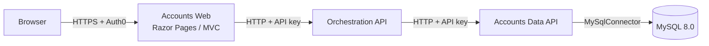

# Accounts System

A multi-service accounts application built with ASP.NET Core and run with Docker Compose. It is a deliberately small prototype, used to demonstrate service separation, API key authentication between services, secrets management and containerised deployment.

## Architecture



Only the frontend is exposed outside Docker. Each service authenticates the one calling it with its own API key, and only the Data API can reach the database.

| Service | Compose name | Role | Docs |
|---|---|---|---|
| Accounts Web | `web` | User interface and Auth0 sign-in | [README](src/Accounts.Web/README.md) |
| Orchestration API | `orchestration-api` | Application-facing API, calls the Data API | [README](src/Accounts.OrchestrationApi/README.md) |
| Accounts Data API | `data-api` | The only service with database access | [README](src/Accounts.DataApi/README.md) |
| MySQL | `db` | Accounts database | — |

## Technologies

.NET 10, ASP.NET Core, Razor Pages, MVC, Clean Architecture, Domain-Driven Design, Auth0, MySQL 8.0, MySqlConnector, Docker Compose with Docker secrets, xUnit v3.

## Repository structure

```text
accounts-system/
├── src/
│   ├── Accounts.Web/                 Frontend
│   ├── Accounts.OrchestrationApi/    Orchestration API
│   └── Accounts.DataApi/             Data API and its tests
├── mySQLDb/                          Database initialisation script
├── secrets.example/                  Template for the secrets/ folder
├── docker-compose.yaml
└── AccountsSystem.slnx
```

## Quick start

**Prerequisites:** Docker Desktop (or Docker Engine with Compose v2) and an Auth0 application.

**1. Clone the repository**

```bash
git clone https://github.com/ElisesHub/accounts-system.git
cd accounts-system
```

**2. Create the secrets folder from the template**

```bash
cp -r secrets.example secrets
```

Replace every placeholder in `secrets/` with a real value. Each file contains only the value, with no quotes and no trailing newline.

| File | Used by | Value |
|---|---|---|
| `AccountsApiKey.txt` | Orchestration API → Data API | Any strong random string |
| `AccountsApplicationApiKey.txt` | Web → Orchestration API | Any strong random string |
| `Auth0ClientId.txt` | Web | From your Auth0 application |
| `Auth0ClientSecret.txt` | Web | From your Auth0 application |
| `MySQLPassword.txt` | MySQL | Password for the `accounts_user` database user |
| `MySQLRootPassword.txt` | MySQL | Password for the MySQL root user |
| `AccountsDbConnectionString.txt` | Data API | Connection string using the `MySQLPassword.txt` password |

Generate the connection string from the password file, so the two always match:

```bash
printf 'Server=db;Port=3306;Database=AccountsDb;Uid=accounts_user;Pwd=%s;' "$(cat secrets/MySQLPassword.txt)" > secrets/AccountsDbConnectionString.txt
```

`secrets/` is ignored by git. Never commit it.

**3. Set your Auth0 domain**

In `docker-compose.yaml`, set `Auth0__Domain` under the `web` service to your tenant domain. In your Auth0 application settings, add `http://localhost:1000/callback` to Allowed Callback URLs and `http://localhost:1000` to Allowed Logout URLs.

**4. Build and start**

```bash
docker compose up --build
```

Open **http://localhost:1000**.

## Everyday commands

| Task | Command |
|---|---|
| Start in the background | `docker compose up --build -d` |
| Follow all logs | `docker compose logs -f` |
| Follow one service | `docker compose logs -f data-api` |
| Check status | `docker compose ps` |
| Stop | `docker compose down` |
| Stop and delete the database | `docker compose down -v` |

## Database

On first start, MySQL creates `AccountsDb` and `accounts_user`, then runs `mySQLDb/accountsdb_dump_v1.sql`. This runs **only when the volume is first created**. To re-run it after changing the script, or after changing `MySQLPassword.txt`:

```bash
docker compose down -v
docker compose up --build
```

`down -v` deletes all database data.

## Local development without Docker

Each service can run with `dotnet run` or from Rider using its launch profile. Non-secret settings are in each project's `appsettings.Development.json`, and secrets in .NET user secrets. See each service's README.

| Service | Local URL |
|---|---|
| Accounts Web | http://localhost:5236 |
| Orchestration API | http://localhost:5182 |
| Accounts Data API | http://localhost:5253 |

Open `AccountsSystem.slnx` to work on all projects together.

## Tests

```bash
dotnet test
```

## Design notes

- **One responsibility per service.** The frontend never sees the database, and only the Data API holds database credentials.
- **Service-to-service authentication.** Each API validates an `x-api-key` header, with a separate key per hop.
- **Secrets as files, not environment variables.** Passwords and keys are Docker secrets mounted under `/run/secrets`, so they don't appear in `docker inspect` or process environments. The .NET services read them through the key-per-file configuration provider.
- **Fail fast on configuration.** Every service validates its required settings at startup.
- **Least privilege in the database.** The Data API connects as `accounts_user`, not root.

## Planned improvements

- Switch the Orchestration → Data API call to gRPC, with a shared `.proto` contract
- Run the integration tests against a disposable MySQL container with Testcontainers
- Add a GitHub Actions pipeline for build and tests
- Align project and namespace names with the `Accounts.*` folders

## Troubleshooting

**`bind source path does not exist: .../secrets/...`**: a secret file is missing or misnamed. Compare `ls secrets` with the table above. Names are case-sensitive.

**`Access denied for user 'accounts_user'`**: the password in `AccountsDbConnectionString.txt` doesn't match the one MySQL was initialised with. Regenerate the connection string with the `printf` command above. If `MySQLPassword.txt` changed after the first start, reset the volume.

**`Unable to connect to any of the specified MySQL hosts`**: the connection string must use `Server=db`, the compose service name, not `localhost`.

**`PROCEDURE AccountsDb.GetAccounts does not exist`**: the database was not initialised from the dump. Reset the volume.

**A page shows an error**: follow the request through `docker compose logs web orchestration-api data-api` to find which service failed.

## Disclaimer

This project is a simple prototype created for demonstration purposes only. It is provided "as is", without warranty of any kind. It is not intended to be used as-is in production. Before any public or commercial deployment, review the security configuration, secrets management, database setup, authentication flow, error handling, logging and infrastructure settings.